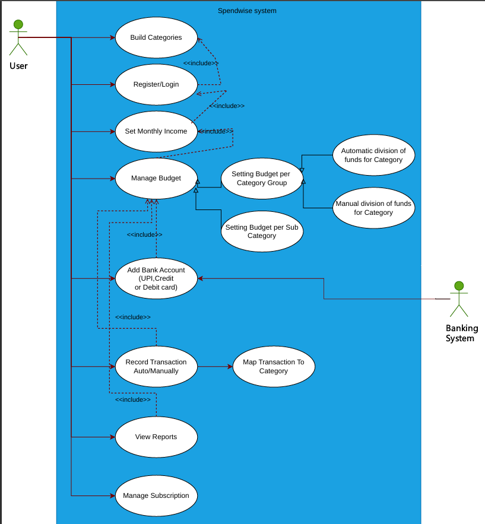
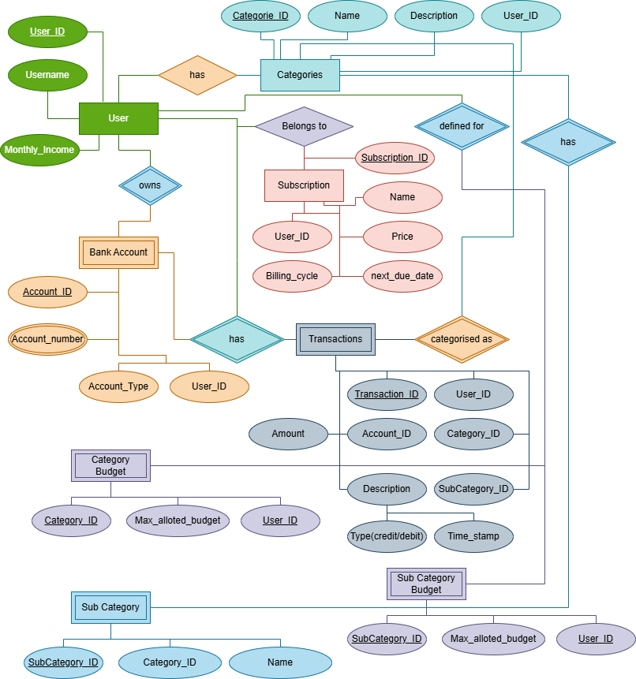

# SpendWise

SpendWise is a backend\-first personal finance management application built with **Java and Spring Boot**.

The project provides REST APIs for managing personal finances, including accounts, transactions, budgets, financial goals, analytics, and user\-specific financial data. It uses JWT\-based authentication and authorization to ensure that users can access only their own resources.

## Tech Stack

- Java
- Spring Boot
- Spring Security
- JWT Authentication
- Spring Data JPA / Hibernate
- PostgreSQL
- JUnit 5
- Mockito
- MockMvc
- Maven
- Docker
- GitHub Actions
- Azure Container Apps

## Core Features

### Authentication & Authorization

- User registration and login
- JWT\-based authentication
- Protected REST endpoints
- User\-specific resource ownership and authorization

### Account Management

- Create and manage financial accounts
- Track account balances
- Associate accounts with authenticated users

### Transactions

- Record income and expenses
- Categorize financial activity
- Filter transactions using date\-based criteria
- Track spending across accounts

### Budgeting

- Create and manage budgets
- Monitor spending against configured budgets

### Financial Goals

- Create savings and financial goals
- Track progress toward goals

### Analytics & Dashboard

SpendWise exposes dashboard APIs for analyzing financial activity, including:

- Cash\-flow insights
- Spending analysis
- Balance analytics
- Budget information
- Financial summaries

## Architecture

The backend follows a layered architecture:

**Controller → Service → Repository → Database**

DTOs are used between the API and application layers to avoid directly exposing persistence entities.

Authentication and authorization are handled through Spring Security and JWT.

## System Design

### Use Case Diagram

The use case diagram represents the primary interactions available within SpendWise, including income management, budgeting, transaction tracking, and other personal finance operations.

### Entity Relationship Diagram

The ER diagram represents the primary entities, relationships, and database structure used by the SpendWise backend.

## Testing

The backend includes automated tests using:

- **JUnit 5** for testing
- **Mockito** for mocking dependencies
- **MockMvc** for testing REST controllers

The test suite covers service\-layer business logic and controller behavior independently of external dependencies.

## Running Locally

### Prerequisites

Install:

- Java
- Maven
- PostgreSQL

Configure the required database and application environment variables before starting the application.

Run the application using:

mvn spring\-boot:run

The application can also be packaged using:

mvn clean package

## Docker

SpendWise can be packaged as a Docker container for deployment.

Build the image using:

docker build \-t spendwise .

Run it using the required application environment variables and database configuration.

## Deployment

The backend is being containerized and deployed using:

**GitHub → GitHub Actions → Docker → Azure Container Apps**

Automated deployment through GitHub Actions and Azure Container Apps is currently being configured.

## Project Status

**Backend V1: Complete**

Current focus:

- Azure Container Apps deployment
- CI/CD
- React frontend integration

Future functionality and architectural improvements will be considered separately for V2.

## Why I Built SpendWise

SpendWise was built as a practical backend project to explore production\-oriented Spring Boot development beyond basic CRUD APIs.

The project focuses on areas such as authentication, authorization, database design, API architecture, financial calculations, automated testing, containerization, and cloud deployment.

